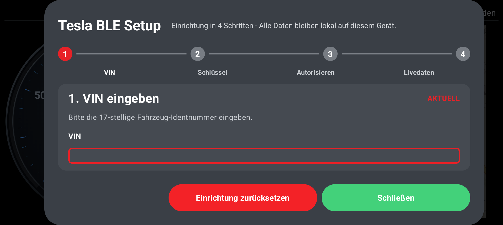
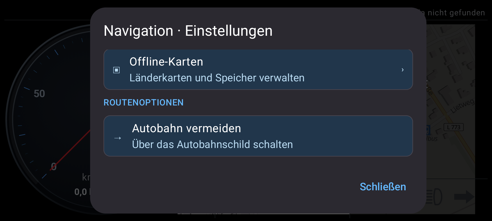
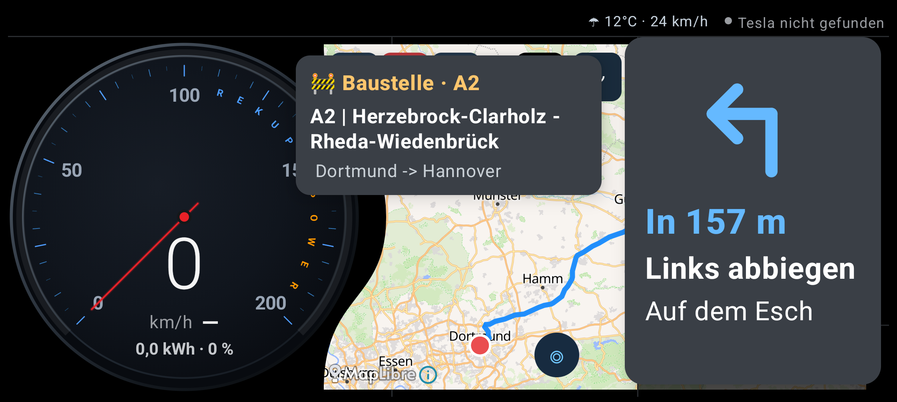
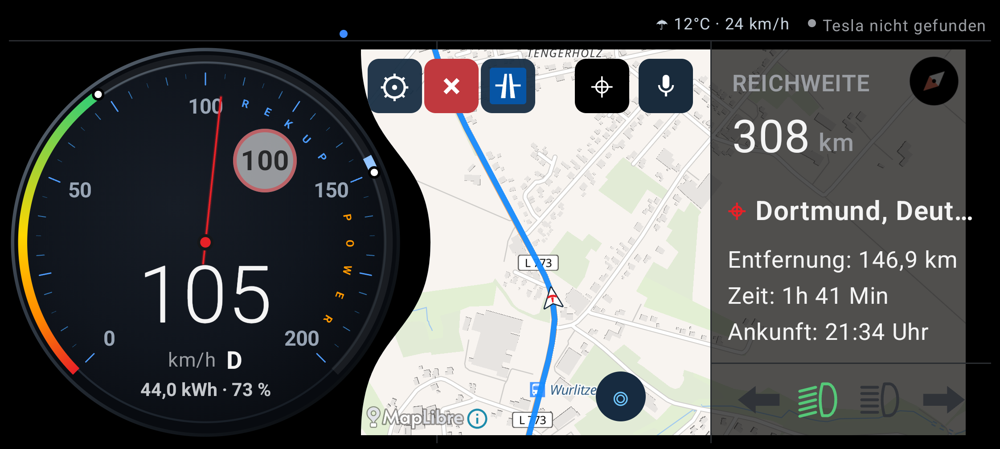
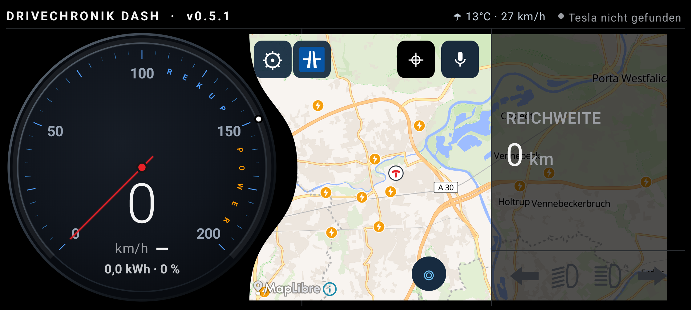
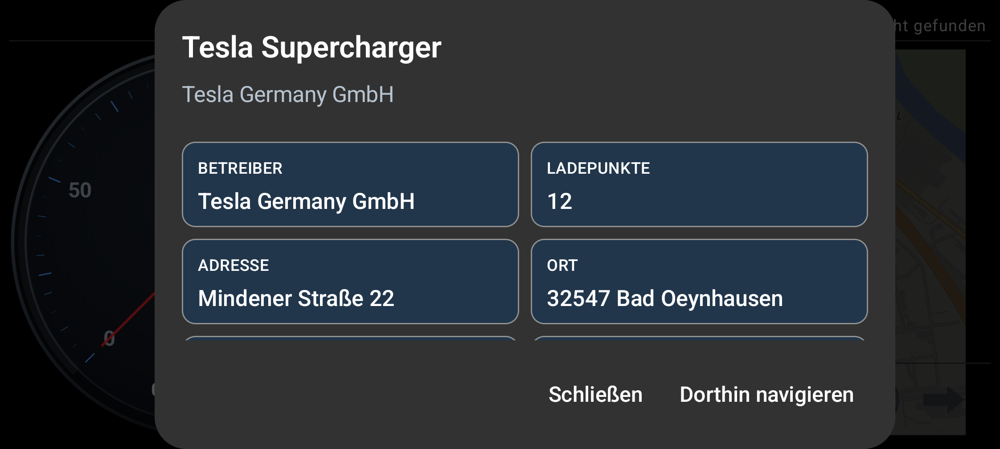

# drivechronik-dash

Lokales Android-Dashboard und Navigationssystem für Tesla-Fahrzeuge.

**Aktuelle Version: 0.5.4**

## Projektbeschreibung

drivechronik-dash ist ein natives Android-Dashboard
mit lokaler Bluetooth-Anbindung an Tesla-Fahrzeuge.

Die Anwendung kombiniert Fahrzeugdaten, digitales Cockpit,
Navigation, Online- und Offline-Karten, Ladeinfrastruktur
sowie Verkehrsinformationen in einer gemeinsamen Oberfläche.

Der Schwerpunkt liegt auf einer möglichst lokalen Verarbeitung
der Fahrzeug- und Navigationsdaten.

## Dashboard

- Plastischer digitaler 3D-Tacho
- Geschwindigkeitsanzeige
- Dynamische Ganganzeige
- Restenergie mit fließendem Farbverlauf
- Leistungsring mit POWER und REKUP
- Reichweitenanzeige
- Navigationsinformationen
- Automatischer Tag-/Nachtmodus
- Halbtransparenter rechter KPI-Bereich
- Kartenansicht bis unter den KPI-Bereich
- Anzeigen für Blinker und Fahrzeugbeleuchtung

## Screenshots

## Tesla-Bluetooth

- Lokaler BLE-Scan
- Fahrzeugidentifikation über VIN
- Geführte Einrichtung
- Tesla-Schlüsselregistrierung
- Verschlüsselte Kommunikation
- Tesla-Session-Verwaltung
- Verarbeitung von Fahrzeugdaten
- Smartphone-GPS und Tesla-BLE als Positionsquellen

Die privaten Fahrzeugschlüssel werden über den
Android KeyStore verwaltet und nicht im Git-Repository gespeichert.

## Navigation

- Online-Routing
- Offline-Routing mit Valhalla
- Kartenansicht mit MapLibre
- Smartphone-GPS oder Tesla-BLE
- Abbiegehinweise und Reststrecke
- Automatisches Rerouting bei Fehlfahrten
- Fahrtrichtungsabhängige Kameraführung
- Geschwindigkeitsabhängiger Kartenzoom
- Navigationspfeil mit Tesla-Symbol
- Kreisverkehrsanzeige mit realer Ausfahrtsgeometrie
- Vermeidung von Autobahnen
- Navigation jederzeit beenden
- Navigationssimulation für Tests

## Online- und Offline-Karten

drivechronik-dash unterstützt sowohl Online-Karten
als auch lokal installierte Offline-Karten.

Offline-Pakete können länderweise verwaltet werden.

Aktuell werden unter anderem unterstützt:

- Deutschland
- Dänemark

Die Karten- und Routing-Pakete werden separat über
das Projekt **drivechronik-maps** bereitgestellt.

Ein Offline-Paket kann enthalten:

- MapLibre-Kartendaten
- Valhalla-Routingdaten
- Ladeinfrastruktur

Damit können Kartenanzeige und Routenberechnung
auch ohne permanente Internetverbindung genutzt werden,
sofern die benötigten Pakete lokal installiert sind.

## Ladeinfrastruktur

- Lokale Ladepunkte aus den Kartenpaketen
- Ladepunkte auch über der Online-Karte darstellbar
- Tesla Supercharger
- Schnellladestationen
- Normale Ladepunkte
- Unterschiedliche Anzeige abhängig von der Zoomstufe
- Ladepunkte auf der Karte antippbar
- Navigation zu ausgewählten Ladestationen

Die Ladeinfrastruktur ist unabhängig davon nutzbar,
ob die Online- oder Offline-Basiskarte angezeigt wird.

## Verkehrsinformationen

Ab Version 0.5.0 können aktuelle Verkehrsinformationen
für deutsche Autobahnen eingeblendet werden.

Unterstützt werden unter anderem:

- Baustellen
- Warnmeldungen
- Straßensperrungen

Die Daten werden routenbezogen ausgewertet und
als Hinweis während der Navigation angezeigt.

Für Live-Verkehrsinformationen ist eine
Internetverbindung erforderlich.

Eine automatische Routenneuberechnung ausschließlich
aufgrund einer Verkehrsmeldung ist derzeit nicht aktiviert.

## Sprachsteuerung

Aktivierungswort: **DriveChronik**

- Lokale Aktivierungswort-Erkennung mit Vosk
- Deutsches Sprachmodell
- Mikrofon über Symbol ein-/ausschaltbar
- Zieleingabe per Sprache
- Zielkontrolle vor Navigationsstart
- Fadenkreuz für manuelle Zielsuche

Die Aktivierungswort-Erkennung erfolgt lokal.

Für die eigentliche Android-Spracherkennung
kann abhängig vom verwendeten Sprachdienst
eine Internetverbindung erforderlich sein.

Das Vosk-Modell wird nicht in Git gespeichert.

Zur Einrichtung:

    scripts/install-voice-model.sh

## Erweiterte Sprachbedienung

- Navigation per Sprache starten und stoppen
- Interne Spracheingabe ohne zusätzliches Google-Popup
- Eigener Doppelklang zur Aktivierung
- Gesprochene Zielbestätigung
- Ja/Nein-Antwort ohne erneutes Aktivierungswort
- Begrenztes Antwortzeitfenster
- Angepasste Aussprache von Postleitzahlen

## Demo- und Simulationsmodus

Die App enthält einen Simulationsmodus zur
Entwicklung und Prüfung der Navigation.

Unter anderem können getestet werden:

- Geschwindigkeit
- Energieverbrauch
- Streckenführung
- Fehlfahrten
- Rerouting
- Navigationshinweise
- Kreisverkehre

Die Restenergie beginnt im Demo-Modus zunächst
für fünf Sekunden bei 100 % und wechselt danach
sanft auf den simulierten Akkustand.

Demo-Daten werden nicht als echte
Fahrzeugdaten behandelt.

## Diagnose

- Lokale Telemetrie-Diagnose
- Diagnose-Steuerung in der App
- Service-Modus-Steuerelemente
- BLE-Diagnose
- Navigations- und GPS-Diagnose

Die Diagnosefunktionen dienen überwiegend
der Entwicklung und Fehlersuche.

## Kartenpakete

Die großen Offline-Daten werden bewusst
nicht direkt in diesem Repository gespeichert.

Karten, Routingdaten und Ladeinfrastruktur:

**Pischleuder1/drivechronik-maps**

Dadurch bleibt die Android-Anwendung unabhängig
von den jeweiligen Länder- und Kartenversionen.

## Bekannte Einschränkungen

Einige Tesla-Bluetooth-Telemetriewerte befinden sich
weiterhin in der Erprobung.

Insbesondere einzelne Live-Telemetriewerte sind noch
nicht für jeden Fahrzeugzustand abschließend verifiziert.

Live-Verkehrsinformationen benötigen Internetzugang.

Eine automatische Umleitung aufgrund von Baustellen
oder Straßensperrungen ist derzeit noch nicht aktiviert.

## Build

Voraussetzungen:

- Android SDK
- Gradle-Projektumgebung
- Passende Java-Installation
- Konfigurierte Release-Signierung

Release erstellen:

    ./gradlew clean :app:assembleRelease

APK installieren:

    adb install -r app/build/outputs/apk/release/app-release.apk

Die Installation mit `adb install -r` aktualisiert
eine vorhandene Installation, ohne deren App-Daten
automatisch zu löschen.

## Versionen

- **0.2.0** – Navigation und signiertes Release
- **0.3.0** – 3D-Tacho und Leistungsanzeige
- **0.4.0** – Mehrländer-Offlinedaten, Ladeinfrastruktur und erweiterte Navigation
- **0.4.1** – Online-Autobahnvermeidung und Routing-Verbesserungen
- **0.4.2** – Verbesserte Kreisverkehrs- und Abbiegeführung
- **0.5.0** – Live-Verkehrsinformationen für Autobahnen
- **0.5.1** – Ladepunkte auf Online-Karten und überarbeitetes Karten-/KPI-Layout
- **0.5.4** – Verkehrs-Replay sowie Blinker- und Lichtanzeigen direkt im Tacho

Weitere technische Details und Änderungen enthält:

    CHANGELOG.md

## Entwicklungsstatus

Das Projekt befindet sich in aktiver Entwicklung.

Navigation, Online-/Offline-Karten, Ladeinfrastruktur
und das Dashboard werden laufend weiterentwickelt.

Nicht alle Tesla-Telemetriewerte sind bereits für
jeden Fahrzeugzustand abschließend verifiziert.
